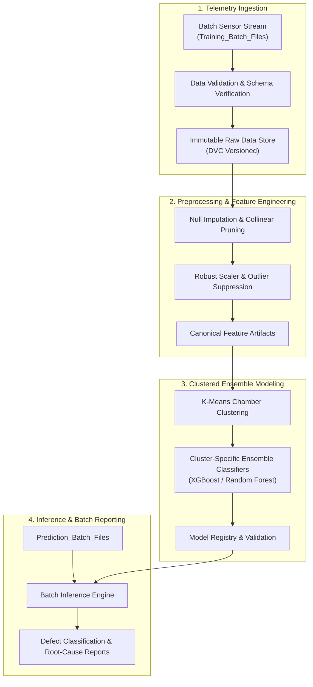

# 🔬 WaferGuard: Intelligent Predictive Maintenance for Semiconductor Wafers

> **Production MLOps Pipeline & Sensor Anomaly Detection for Semiconductor Manufacturing**  
> Automated fault detection, wafer batch quality classification, and predictive maintenance built on modular data pipelines, DVC versioning, and standardized model evaluation.

<p align="center">
  
  
  
  
</p>

---

## 🏭 Industrial Context

In semiconductor fabrication plants (fabs), wafer defects detected post-packaging result in astronomical yield loss and equipment downtime. Real-time telemetry streaming from hundreds of sensor chambers across chemical mechanical planarization (CMP), photolithography, and plasma etching must be continuously audited for sub-micron sensor deviations.

**WaferGuard** implements an industrial-grade predictive maintenance architecture that ingests raw telemetry batches, detects sensor drift, trains high-recall classification models, and serves automated prediction reports across batch manufacturing runs.

---

## ⚡ MLOps Lifecycle & Data Flow



---

## 🛠️ Engineering Workflows (Makefile Powered)

WaferGuard leverages structured `make` targets to maintain reproducible pipelines:

| Command | Operational Scope |
| :--- | :--- |
| `make requirements` | Verifies Python environment and installs pinned dependencies |
| `make data` | Ingests and validates raw sensor telemetry batches via DVC |
| `make clean` | Removes compiled artifacts, stale caches, and intermediate batches |
| `make lint` | Enforces flake8 and PEP8 compliance across `src/` modules |
| `make sync_data_to_s3` | Synchronizes versioned datasets to remote S3 blob storage |
| `make sync_data_from_s3`| Pulls verified training batches from S3 data lake |

---

## 🚀 Quickstart & Pipeline Reproduction

### 1. Environment Setup
```bash
git clone https://github.com/krishujeniya/WaferGuard.git
cd WaferGuard
python3 -m venv .venv
source .venv/bin/activate
pip install -r requirements.txt
```

### 2. Ingest Data & Trigger Pipeline
```bash
# Verify environment dependencies
python test_environment.py

# Execute automated pipeline
make data
```

---

## 📁 Repository Organization

```
├── .dvc/                  # Data Version Control configuration & remotes
├── Makefile               # Standardized MLOps automation targets
├── Prediction_Batch_files # Production inference telemetry batches
├── Training_Batch_Files   # Historical labeled wafer sensor batches
├── docs/                  # Sphinx technical documentation suite
├── models/                # Serialized model artifacts & cluster estimators
├── notebooks/             # Exploratory signal analysis & sensor diagnostics
├── src/
│   ├── data/              # Ingestion, validation, and schema checking
│   ├── features/          # Feature engineering, transformation, and scaling
│   ├── models/            # Cluster segmentation, training, and evaluation
│   └── visualization/     # Sensor drift and defect distribution analytics
├── tox.ini                # Multi-environment automated testing
└── LICENSE                # MIT Open-Source License
```

---

## 📄 License & Citation

This project is licensed under the [MIT License](LICENSE).

```bibtex
@software{ujeniya2026waferguard,
  author = {Krish Ujeniya},
  title = {WaferGuard: Predictive Maintenance & Sensor Fault Classification for Semiconductor Wafers},
  year = {2026},
  publisher = {GitHub},
  url = {https://github.com/krishujeniya/WaferGuard}
}
```
